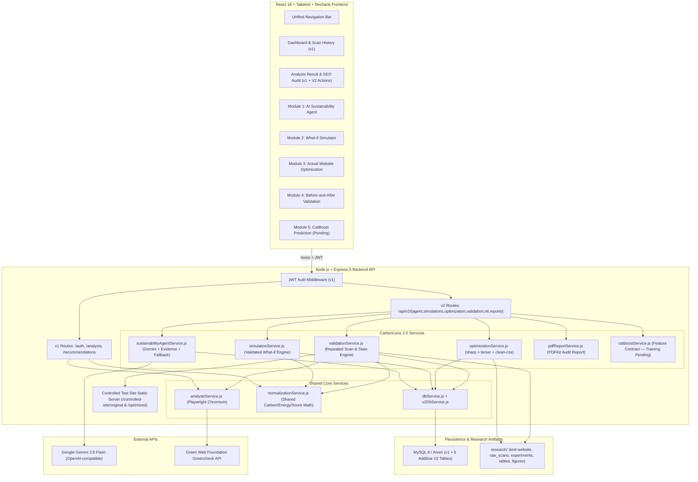
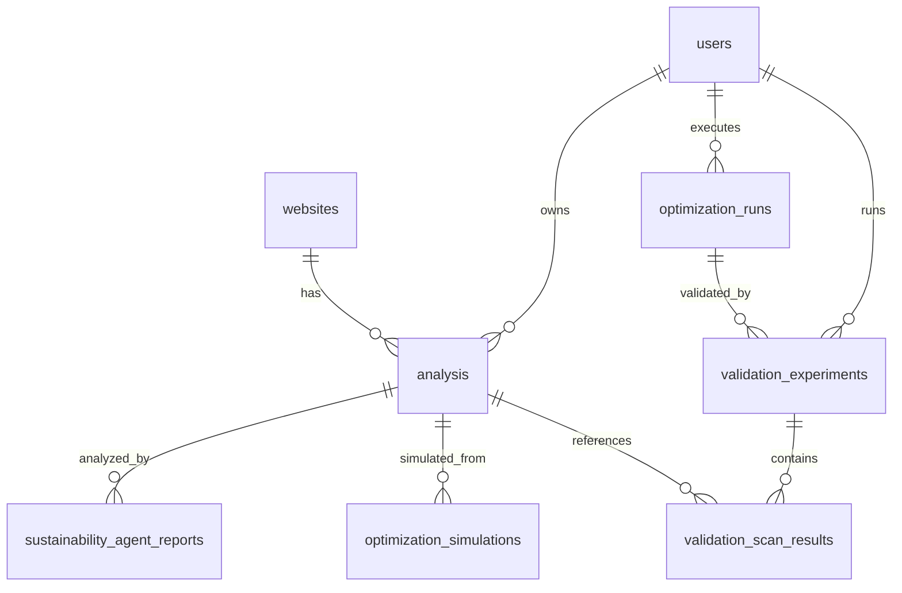

# CarbonLens 2.0 — System Architecture

## 1. Architectural Philosophy

CarbonLens 2.0 extends the existing React + Express + Playwright + MySQL + Gemini platform without replacing working v1 modules. All new analytical, simulation, optimization, validation, and ML-readiness capabilities live in modular backend services under `backend/services/` exposed via versioned REST routes under `/api/v2/*`, while keeping all v1 routes (`/auth`, `/analysis`, `/recommendations`) intact and backward-compatible.

---

## 2. High-Level System Architecture

---

## 3. Data Provenance & Scientific Integrity Separation

Every value produced by CarbonLens 2.0 carries an explicit provenance classification across API responses, UI badges, exports, and PDF reports:

| Category | Meaning | Modules |
|---|---|---|
| **Measured** | Direct browser/network or filesystem observations (bytes transferred, HTTP request counts, TTFB, DOMContentLoaded, load time, file sizes on disk). | Scanner, Module 3 (file sizes), Module 4 (before/after scans) |
| **Calculated Estimate** | Deterministic formulas derived from measured bytes and hosting status (`0.06 kWh/GB`, `312` or `442 gCO2/kWh`, `100 * exp(-0.15 * MB)`). | `normalizationService.js`, Scanner, Module 4 |
| **AI-Generated Recommendation** | Structured prioritization & engineering explanations grounded in scan evidence (or clearly labeled deterministic fallback when Gemini is unavailable). | Module 1 |
| **Simulated / Hypothetical Result** | Projected resource, energy, carbon, and score changes under user-configured reduction assumptions. Never modifies any website. | Module 2 |
| **Actual Optimization Result** | Real asset transformations executed on the owned controlled test website (`research/test-website/original` -> `optimized`) with byte-verified output files. | Module 3 |
| **Pending / Future Work** | Modular CatBoost ML interface ready for future Python/model integration; no trained model or synthetic accuracy metrics. | Module 5 |

---

## 4. Shared Carbon & Sustainability Formula Architecture

To ensure mathematical consistency across scanning, What-if simulation, and before-and-after validation, `backend/services/normalizationService.js` exports a pure calculation function `calculateSustainabilityMetrics({ totalBytes, isGreenHost })`:

- `totalWeightMB = totalBytes / (1024 * 1024)`
- `totalWeightGB = totalBytes / (1024 * 1024 * 1024)`
- `energyPerGB = 0.06` kWh/GB (consistent with existing CarbonLens v1)
- `energyUsedKWh = totalWeightGB * energyPerGB`
- `carbonIntensity = isGreenHost ? 312 : 442` gCO2/kWh
- `co2EstimateGrams = Number((energyUsedKWh * carbonIntensity).toFixed(6))` (displayed to 4 decimals in v1 payloads for backward compatibility)
- `carbonScore = Math.round(100 * Math.exp(-0.15 * totalWeightMB))`
- `grade = calculateGrade(carbonScore)` (`A+`, `A`, `B`, `C`, `D`, `E`, `F`)

All energy and CO2 outputs are explicitly treated as **calculated estimates**, not direct physical hardware power measurements.

---

## 5. Module-by-Module Technical Design

### 5.1 Module 1 — AI Sustainability Agent
- **Service:** `backend/services/sustainabilityAgentService.js`
- **Route:** `backend/routes/v2Agent.js` mounted at `/api/v2/agent`
  - `POST /api/v2/agent/analyze` (body: `{ analysisId }` or raw structured scan metrics)
  - `GET /api/v2/agent/reports` (list user's saved reports)
  - `GET /api/v2/agent/reports/:analysisId` (latest report for a scan)
- **Pipeline:**
  1. Normalize full scan context (page weight, image/JS/CSS/font/other bytes & counts, total & third-party requests, TTFB, DOMContentLoaded, load time, 4G latency, energy estimate, CO2 estimate, score, grade, green hosting status).
  2. Compute deterministic scan evidence signals (e.g., `% of page weight from images/JS/CSS`, request density, third-party ratio, TTFB/load bottlenecks, green hosting status).
  3. Invoke Gemini 2.5 Flash via OpenAI-compatible SDK with a 20s timeout and strict JSON schema instruction.
  4. Validate JSON structure, field completeness, valid priority (`HIGH`/`MEDIUM`/`LOW`), valid difficulty (`LOW`/`MEDIUM`/`HIGH`), and non-empty scan evidence references.
  5. If Gemini fails, times out, hits rate limits, or fails validation -> invoke deterministic evidence-based fallback engine producing the exact same validated schema with `generationMode: "deterministic_fallback"` and `fallbackReason`.
  6. Persist report in `sustainability_agent_reports`.

### 5.2 Module 2 — What-if Optimization Simulator
- **Service:** `backend/services/simulationService.js`
- **Route:** `backend/routes/v2Simulations.js` mounted at `/api/v2/simulations`
  - `GET /api/v2/simulations/scenarios` (returns scenario catalog, bounds, defaults)
  - `POST /api/v2/simulations/preview` (run calculation without saving)
  - `POST /api/v2/simulations` (run calculation & persist to MySQL)
  - `GET /api/v2/simulations` (list saved user simulations)
  - `GET /api/v2/simulations/:id` (retrieve single simulation)
- **Anti-Double-Counting Mathematical Model:**
  - Within each category (Images, JavaScript, CSS, Requests/Third-Party), multiple selected sub-techniques compound multiplicatively rather than additively:
    $$\text{effectiveReduction} = 1 - \prod_{i} (1 - r_i)$$
    capped at a realistic safety ceiling (e.g., `0.95` max category reduction so assets do not vanish impossibly unless explicitly removed, and strictly bounded `[0, 100]`).
  - Request/third-party reduction only applies to the non-already-removed portion of overhead/third-party transfer weight (tracked cleanly via `otherBytes` + unallocated request overhead) so image/JS/CSS bytes are never subtracted twice.
  - Exact reconciliation invariant enforced and asserted on every run:
    `simulatedTotalBytes === simImageBytes + simScriptBytes + simStyleBytes + simFontBytes + simOtherBytes` and all values `>= 0`.

### 5.3 Module 3 — Actual Website Optimization Demonstration
- **Controlled Site:**
  - `research/test-website/original/` — immutable baseline realistic eco-analytics / sustainability showcase website with:
    - Multiple real high-resolution uncompressed/heavy PNG & JPEG images generated programmatically with rich visual detail (charts, hero banner, product cards, gallery photos).
    - Multiple unminified JavaScript files including verbose comments/helpers AND an intentionally unused legacy script (`legacy-unused-widget.js`) loaded on the page.
    - Multiple unminified CSS stylesheets including verbose rules AND an intentionally unused stylesheet (`legacy-print-unused.css`) loaded on the page.
    - Multiple HTTP requests mimicking real-world unoptimized sites.
  - `research/test-website/optimized/` — generated exclusively by `optimizationService.js`.
- **Service:** `backend/services/optimizationService.js`
  - **Image Optimization (`sharp`):** resizes oversized images to sensible max display dimensions, compresses and converts to WebP (`quality: 75`), updates HTML `<picture>` / `` references, verifies every output image via `sharp(outputPath).metadata()`, records original bytes, optimized bytes, format, dimensions, and `%` reduction.
  - **JavaScript Optimization (`terser`):** minifies active JS bundles, removes genuinely unused scripts from the controlled site's HTML (verified against DOM usage), adds `defer` where safe, verifies syntax/validity, records exact byte reductions.
  - **CSS Optimization (`clean-css`):** minifies active stylesheets, strips unused CSS rules/stylesheets on the controlled site, preserves visual layout, records exact byte reductions.
- **Route:** `backend/routes/v2Optimization.js` mounted at `/api/v2/optimization`
  - `GET /api/v2/optimization/site-status` (inspect original & optimized files and sizes)
  - `POST /api/v2/optimization/run` (execute selected optimizations: `{ images: true, javascript: true, css: true, imageQuality, maxImageWidth }`)
  - `GET /api/v2/optimization/runs` (history of optimization runs)
  - `GET /api/v2/optimization/runs/:id` (detailed run log)

### 5.4 Module 4 — Before-and-After Validation
- **Service:** `backend/services/validationService.js`
- **Route:** `backend/routes/v2Validation.js` mounted at `/api/v2/validation`
  - `POST /api/v2/validation/run` (runs `N` repeated Playwright scans on original + `N` scans on optimized using identical Chromium config, persists experiment & individual scans, computes mean/min/max/stdDev and before-vs-after deltas)
  - `GET /api/v2/validation/experiments` (list experiments)
  - `GET /api/v2/validation/experiments/:id` (full experiment detail)
  - `GET /api/v2/validation/experiments/:id/export?format=csv|json` (downloadable research exports)
- **Zero-Denominator Safety:** All percentage deltas use `baseline === 0 ? null : ((baseline - optimized) / baseline) * 100` (never `Infinity` or `NaN`).

### 5.5 Module 5 — CatBoost Carbon Prediction (Architecture-Ready)
- **Service:** `backend/services/catboostService.js`
- **Route:** `backend/routes/v2Ml.js` mounted at `/api/v2/ml`
  - `GET /api/v2/ml/status` — returns `status: "TRAINING_PENDING"`, feature schema, planned targets, planned evaluation metrics, and integration contract.
  - `POST /api/v2/ml/extract-features` — extracts real feature vectors from an existing `analysisId` ready for future CatBoost inference.
  - `POST /api/v2/ml/predict` — explicitly returns HTTP `503` / `status: "MODEL_NOT_TRAINED"` (never fabricates predictions).

### 5.6 PDF Sustainability Audit Report
- **Service:** `backend/services/pdfReportService.js` (`pdfkit`)
- **Route:** `backend/routes/v2Reports.js` mounted at `/api/v2/reports`
  - `GET /api/v2/reports/:analysisId/pdf` — generates and streams a structured multi-section PDF combining scan measurements, calculated energy/carbon estimates, AI Sustainability Agent findings, latest What-if simulation (if any), actual optimization run & before-and-after validation (if requested/available), and methodology disclosures with explicit provenance tags on every section.

---

## 6. Database Schema Additions

All foreign keys enforce `ON DELETE CASCADE` (or `SET NULL` where optional) and all queries filter by `user_id` for strict multi-user isolation.
